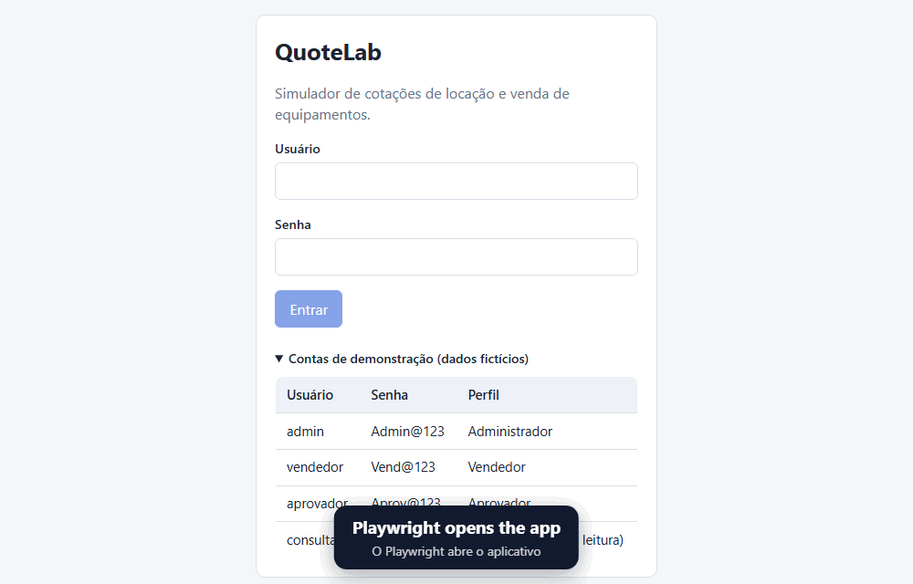
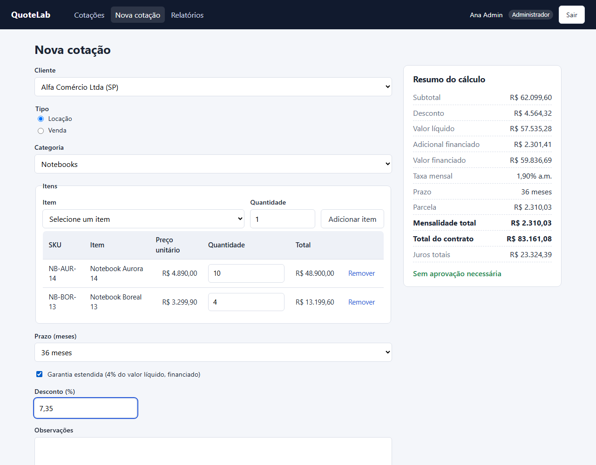
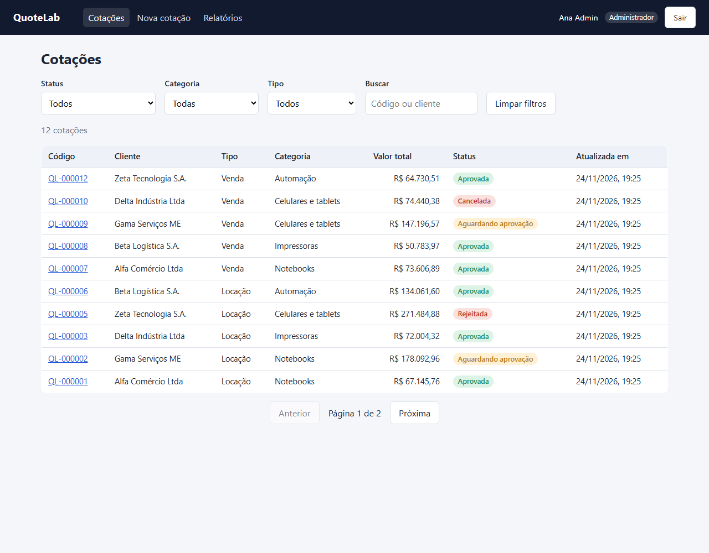
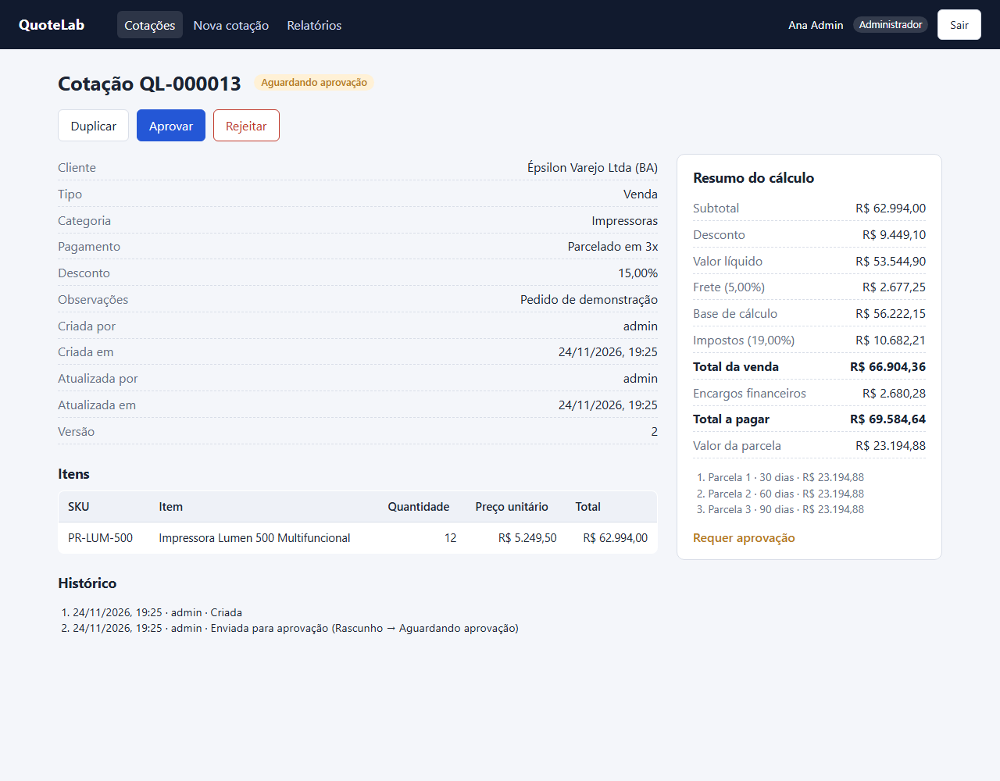
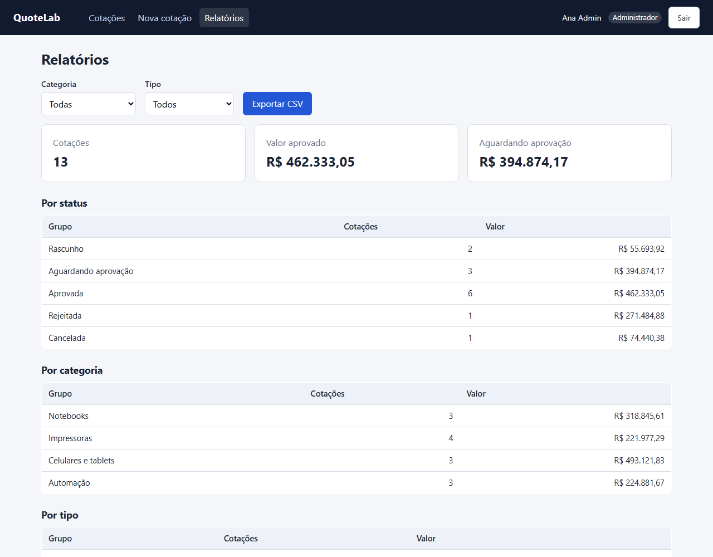
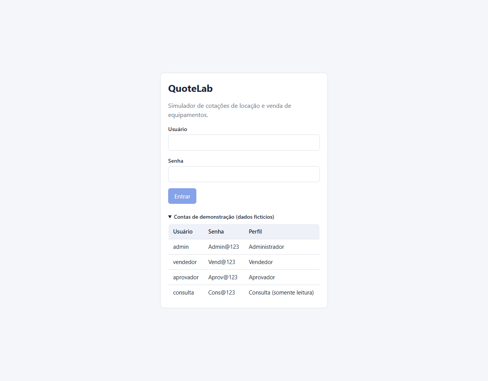

# QuoteLab · QA automation showcase

[](https://github.com/LucasBonno/qa-automation-showcase/actions/workflows/ci.yml)
[](https://playwright.dev)
[](LICENSE)

🇬🇧 English · 🇧🇷 [Português](README.pt-BR.md)

An end-to-end test automation project built with **Playwright and TypeScript**. It tests **QuoteLab**, a small quote simulator for equipment leasing and sales that lives in this same repository, so anyone can clone it and run **all 415 tests in about two and a half minutes**, with no accounts, no external services and no setup beyond `npm install`.

> **Live reports:** <https://lucasbonno.github.io/qa-automation-showcase/> (published by the CI on every push to `main`).
>
> QuoteLab and all its data are fictional. This repository is not related to any employer or client.



**Contents:** [In plain words](#in-plain-words) · [Try it](#try-it) · [What this project shows](#what-this-project-shows) · [Scope](#scope-what-this-repository-is-and-what-it-is-not) · [The test suites](#the-test-suites) · [How a calculation is verified](#how-a-calculation-is-verified) · [Architecture](#architecture) · [Screens](#screens) · [All commands](#all-commands)

## In plain words

QuoteLab is a small web application in which a salesperson builds a quote to **rent or sell equipment** (notebooks, printers, phones, scanners). It calculates installments, discounts, freight and tax, and sends large or heavily discounted quotes to an approver.

This project is the **automated test suite** that checks that application the way a careful tester would, only in minutes and on every change to the code:

- It opens a real browser, fills in the forms and **compares every number on screen with an independent calculation**.
- It talks straight to the API to try invalid and malicious input.
- It checks who can do what (administrator, seller, approver, viewer).
- It runs by itself in the cloud on every push, and the result is public.

This is how a test reads (simplified):

```ts
test('summary shows the oracle values: three SKUs, 36 months, 7,35% discount', async ({ openAs, formPage }) => {
  await openAs('admin', '#/quotes/new');   // sign in as administrator and open the new-quote form
  await formPage.fillLease(scenario);      // pick customer, items, term, add-on and discount, like a user
  await expectLeaseSummary(formPage.summary, expectedLease(scenario)); // each row on screen == independent calculation
});
```

## Try it

### Option 1: see it, without installing anything (1 minute)

| What | Where |
|---|---|
| Did the tests pass? | The green **CI** badge at the top of this page: every push runs all 416 steps on a clean Linux machine |
| The test report, with screenshots and traces | <https://lucasbonno.github.io/qa-automation-showcase/> |
| The run summary in one page | [English](https://lucasbonno.github.io/qa-automation-showcase/summary/index.en.html) · [Português](https://lucasbonno.github.io/qa-automation-showcase/summary/index.pt.html) |
| What the application looks like | The [screens](#screens) below |
| The logs of a real run | The [Actions](https://github.com/LucasBonno/qa-automation-showcase/actions) tab |

### Option 2: run it on your computer, step by step (about 5 minutes)

**You need two free programs.** If you already have them, skip this.

| Program | Download | Check that it works |
|---|---|---|
| Git | <https://git-scm.com/downloads> | open a terminal and type `git --version` |
| Node.js (the "LTS" version, 20.12 or newer) | <https://nodejs.org> | type `node -v` |

**1. Open a terminal.** It is the window where you type commands.
- **Windows:** press the `Windows` key, type `PowerShell` and press Enter.
- **macOS:** press `Cmd + Space`, type `Terminal` and press Enter.
- **Linux:** press `Ctrl + Alt + T`.

**2. Download the project.** Copy each block, paste it in the terminal and press Enter.

Windows (PowerShell). Use a folder outside OneDrive, which tries to sync thousands of small files:
```powershell
mkdir C:\dev
cd C:\dev
git clone https://github.com/LucasBonno/qa-automation-showcase.git
cd qa-automation-showcase
```

macOS or Linux:
```bash
cd ~
git clone https://github.com/LucasBonno/qa-automation-showcase.git
cd qa-automation-showcase
```

**3. Install what the project needs** (only the first time; the browser download is about 130 MB):
```bash
npm install
npx playwright install chromium
```

**4. Run the quick check** (13 tests, about 8 seconds):
```bash
npm run smoke
```
You should see `13 passed`.

**5. Run everything** (about 2.5 minutes):
```bash
npm test
```
You should see `416 passed` (the 415 tests plus one step that restores the sample data).

**6. Open the report.** It opens in your browser:
```bash
npm run report
```

Every command above must be typed **inside the `qa-automation-showcase` folder**. If you see "Missing script" or "package.json not found", you are in the wrong folder: repeat `cd qa-automation-showcase`.

### Want to watch the tests happen?

**The whole run, one browser window at a time** (about 3 to 4 minutes):
```bash
npm run test:watch
```

**One suite, slowly enough to follow by eye** (the best way to demo it):
```bash
npm run suite -- lease-notebooks --headed
```
A real browser opens and fills the quote form on its own. Replace `lease-notebooks` with any suite: `smoke`, `access`, `api`, `workflow`, `lease-mobile`, `sale-printers`, `reports`, and so on.

Tests are fast, so add a pause between the browser actions with `PW_SLOWMO` (in milliseconds):

| Terminal | Command |
|---|---|
| PowerShell (Windows) | `$env:PW_SLOWMO = 300` then `npm run test:watch` |
| macOS, Linux | `PW_SLOWMO=300 npm run test:watch` |

With a pause the full run takes much longer, so it is better to combine it with a single suite. To go back to full speed in PowerShell: `Remove-Item Env:PW_SLOWMO`. Suites that only call the API (`api`) open no window, because they have no screen.

For a guided view where you click a test and see each step with its screen:
```bash
npx playwright test --no-deps --project=smoke --ui
```

### Want to use the application by hand?

```bash
npm run app
```
Open <http://localhost:4173> and sign in with `admin` / `Admin@123` (the other three accounts are listed on the login screen). Create a quote, change the discount, and watch the calculation panel update. Stop with `Ctrl + C`.

### Something went wrong?

| Symptom | What to do |
|---|---|
| `git` or `node` "is not recognized" | The program is not installed, or the terminal was opened before the installation. Install it and open a new terminal |
| Port 4173 is already in use | Use another port. PowerShell: `$env:PORT=4180`. macOS and Linux: `export PORT=4180`. Then run the command again |
| `ENOENT` errors on `.trace` files (Windows with OneDrive or Dropbox) | The sync client is locking the folder. Run `$env:PW_OUTPUT_DIR="$env:TEMP\pw-out"` before the tests, or clone to a folder outside OneDrive |
| "Executable doesn't exist" / browser not found | Run `npx playwright install chromium` again |
| Still stuck | Open an [issue](https://github.com/LucasBonno/qa-automation-showcase/issues) with the text of the error |

## What this project shows

| Skill | Where to look |
|---|---|
| **Calculation oracles**: every amount on screen is checked against an independent formula, in exact `BigInt` arithmetic, never against the app's own code | [`framework/oracles/`](framework/oracles) |
| **Layered design**: Page Objects for screens, a typed API client, fixtures that clean up after themselves, scenario factories | [`framework/`](framework) |
| **One flow, many categories**: the same lease and sale scripts run for four equipment categories, each with its own rate, limit and add-on | [`framework/suites/`](framework/suites) |
| **Boundary-driven data**: the approval threshold is *found* with the oracle (binary search) and tested one unit on each side | [`framework/factory/scenarios.ts`](framework/factory/scenarios.ts) |
| **Deterministic UI tests**: no sleeps. The app publishes its render state, and tests wait for it | [`BasePage.ready`](framework/pages/base.page.ts) |
| **Access control**: a full role × action matrix, forged tokens, expired sessions, two browser tabs | [`suites/access/`](suites/access) |
| **API contract and persistence**: validation messages, state machine, optimistic locking, audit trail checked in the data store | [`suites/api/`](suites/api) |
| **Execution design**: project dependencies, a smoke gate, read-only suites in parallel, data-changing suites alone and last | [`playwright.config.ts`](playwright.config.ts) |
| **Do the tests catch bugs?** A mutation check injects 10 deliberate defects and verifies the suites fail | [`scripts/mutation-check.mjs`](scripts/mutation-check.mjs) |
| **CI/CD**: type check, lint, full run, reports published to GitHub Pages | [`.github/workflows/ci.yml`](.github/workflows/ci.yml) |
| **Own reporter**: a one-page run summary in Portuguese and English | [`framework/reporter/`](framework/reporter) |

## Scope: what this repository is, and what it is not

QuoteLab is intentionally small. It exists so the **techniques** can be shown in public, running end to end, on a system I fully control. It is not a copy of any system I have worked on, and it does not try to match the size of one.

These patterns come from my day-to-day work on a large, private B2B web platform for commercial proposals and pricing. Its code and data are not mine to publish, and that work has difficulties this sandbox deliberately does not have:

| In a large private suite | In this repository |
|---|---|
| A shared test environment that is sometimes slow or unstable. Tests wait for the screen, and a timeout is reported as "slowness", not as a product bug | A local server that starts in seconds and is fully controlled |
| Existing business data that tests must never destroy, so each test first restores the state it needs | Each test creates and cleans up its own data |
| Several product lines on one framework, each with its own business rules | Four categories on one shared script |
| A written book of business rules, each with its origin, used to decide whether a finding is a confirmed bug, a suspicion or expected behaviour | A short rule table (below) |
| Failures cross-checked with the work-item tracker | A one-page run summary |
| More than a thousand UI tests, with verdicts taken from what the screen shows | 415 tests, through the UI and the API |

If you want to talk about the larger system, I am happy to describe the approach in an interview, without disclosing anything confidential.

## The test suites

415 tests in 13 suites. Every row is a different verification; categories reuse the same script on purpose, because each has different numbers (rate, limit, add-on).

| Suite | Tests | What it covers |
|---|---:|---|
| `smoke` | 13 | Health endpoints, protected routes, login of the four profiles, logout. If it fails, nothing else runs. |
| `access` | 41 | Login and token handling, forged and expired tokens, the role × action matrix, what each role sees, tampering with the browser storage, multi-tab sessions. |
| `api` | 50 | CRUD, validation of every field, malformed and oversized bodies, mass assignment, the approval state machine (every status × every action), optimistic locking, persistence and audit trail. |
| `workflow` | 39 | The quote lifecycle through the UI, form validation, XSS in notes, double clicks, two people editing the same quote, edit page behaviour. |
| `lease-notebooks` · `lease-printers` · `lease-mobile` · `lease-automation` | 31 each | Lease calculation (8 scenarios by API and by screen), every term from 12 to 60 months (amortization to zero), quantity limits, approval threshold, the category's add-on. |
| `sale-notebooks` · `sale-printers` · `sale-mobile` | 32 · 26 · 26 | Sale calculation (8 scenarios by API and by screen), freight and tax by state (all six states), cash, extended and installment payment, approval threshold. |
| `reports` | 55 | The quote list (paging, filters, search, back button) and the reports (totals by status, category and type, CSV export), on a known data set restored before the suite. |
| `reports-live` | 9 | Reports reacting to real changes (approve, cancel, reject, delete, edit), and ordering and paging on stable data. Runs alone, last. |

## How a calculation is verified

The test never asks the application what the answer should be. It computes it from the written business rules, in exact arithmetic, and compares the **integer cents** the screen exposes *and* the **text** a user reads.

```ts
// framework/oracles/money.ts: constant installment, exact rational arithmetic
//   PMT = PV · b · Aⁿ / (D · (Aⁿ − Dⁿ))      with A = D + b, D = 10 000, b = rate in basis points
export function pmt(presentValueCents: number, rateBps: number, months: number): number {
  const n = BigInt(months);
  const a = D + BigInt(rateBps);
  const aN = a ** n;
  const dN = D ** n;
  return Number(roundHalfUp(BigInt(presentValueCents) * BigInt(rateBps) * aN, D * (aN - dN)));
}
```

The oracle is itself checked by a property: paying the installment *n* times must leave the loan balance within the rounding residue ([`amortizationResidue`](framework/oracles/money.ts)).

## Do the tests really catch bugs?

`npm run mutation-check` injects one deliberate defect at a time into the application and runs the suite that should notice it. Latest result: **10 of 10 caught**.

| ID | Injected defect | Caught by | Failing tests |
|---|---|---|---:|
| M1 | Rounding: half up becomes round down | `lease-notebooks` | 5 |
| M2 | Approval line: "above 10%" becomes "10% or more" | `lease-printers` | 2 |
| M3 | A seller is allowed to approve quotes | `access` | 3 |
| M4 | Maximum quantity accepts one extra unit | `lease-mobile` | 1 |
| M5 | Installment compounds *n − 1* periods | `sale-printers` | 10 |
| M6 | The list shows every value one cent too high | `reports` | 1 |
| M7 | Stale versions are no longer detected (lost updates) | `api` | 1 |
| M8 | Tax computed on the net value instead of net + freight | `sale-notebooks` | 28 |
| M9 | The CSV loses its UTF-8 byte order mark | `reports` | 1 |
| M10 | The add-on checkbox is ignored in the live preview | `lease-automation` | 6 |

The first version of this script reported one "survivor". Investigating it showed a stale server being reused, not a gap in the tests, so the script now refuses to reuse servers. A test also found a real defect in the app itself (the search box lost focus while typing) which is fixed in this repository.

## Architecture

```text
app/                  QuoteLab: Express + TypeScript API, plain JavaScript front end
framework/
  oracles/            business rules written independently + exact money math
  api/                typed API client (never throws on HTTP errors, so negative tests are easy)
  pages/              Page Objects (roles, labels and test ids, no XPath)
  factory/            scenarios, payload builders, the seed data set
  fixtures/           Playwright fixtures: admin API, per-role API, session injection, auto cleanup
  assertions/         "summary panel equals oracle" in one call
  suites/             the lease and sale scripts shared by the category suites
  reporter/           one-page run summary (pt/en)
suites/               one folder per project: the spec files
scripts/              mutation check, screenshots, site builder
```

More detail in [`docs/architecture.md`](docs/architecture.md).

### Business rules of QuoteLab

| Rule | Value |
|---|---|
| Lease terms | 12, 24, 36, 48 or 60 months |
| Monthly rate by category | Notebooks 1,90% · Printers 2,40% · Mobile 2,90% · Automation 2,20% |
| Add-on by category | Notebooks: warranty (4% of net, financed) · Printers: supplies kit (R$ 45,00/unit/month) · Mobile: insurance (1,2% of net per month) · Automation: installation (R$ 180,00/unit, financed) |
| Discount | 0% to 30%; **above 10%** needs approval |
| Approval by value | Headline value **above R$ 100.000,00** needs approval |
| Sale | net + freight (by state) + tax (by state); cash, extended 30 days (+1,5%) or 2 to 3 installments (1,99% a.m.) |
| Roles | Administrator, Seller (own quotes), Approver, Viewer (read only) |

### Demo accounts

| User | Password | Role |
|---|---|---|
| `admin` | `Admin@123` | Administrator |
| `vendedor` | `Vend@123` | Seller |
| `aprovador` | `Aprov@123` | Approver |
| `consulta` | `Cons@123` | Viewer |

These are sandbox credentials for fictional data, published on purpose (they are also shown on the login screen).

## Screens



| | |
|---|---|
|  |  |
|  |  |

## All commands

| Command | What it does |
|---|---|
| `npm test` | Every suite, in dependency order |
| `npm run test:watch` | The same, with a visible browser, one window at a time |
| `npm run smoke` · `access` · `api` · `workflow` | One core suite (no dependencies) |
| `npm run lease` · `sale` | The four lease or three sale suites |
| `npm run reports` | Restore the seed data, then the report suites, then the live ones |
| `npm run suite -- <project>` | Any single project, for example `npm run suite -- lease-mobile` |
| `npm run list` | List every test without running them |
| `npm run check` | Type check, lint and test discovery |
| `npm run mutation-check` | Inject deliberate defects and verify the tests catch them |
| `npm run site` | Build the GitHub Pages site from the last run |
| `npm run screenshots` | Regenerate the images in `docs/img` |

## Configuration

| Variable | Default | Meaning |
|---|---|---|
| `BASE_URL` | starts its own server on `http://localhost:4173` | Test an already running QuoteLab (it must run with `QL_TEST_MODE=1`) |
| `PORT` | `4173` | Port of the app that Playwright starts |
| `REPORT_LANG` | `pt` | Language of `reports/summary/index.html` (`pt` or `en`; both files are always written) |
| `PW_OUTPUT_DIR` | `reports/test-results` | Where screenshots and traces go |
| `PW_FRESH_SERVER` | unset | `1` never reuses a running server |
| `PW_SLOWMO` | `0` | Milliseconds to wait between browser actions. Use with `--headed` to follow a run by eye, for example `300` |

`QL_TEST_MODE=1` enables three test-only endpoints (reset the data, dump the data store, short-lived tokens). It is never needed to use the app.

## License

[MIT](LICENSE) © Lucas Bonno
