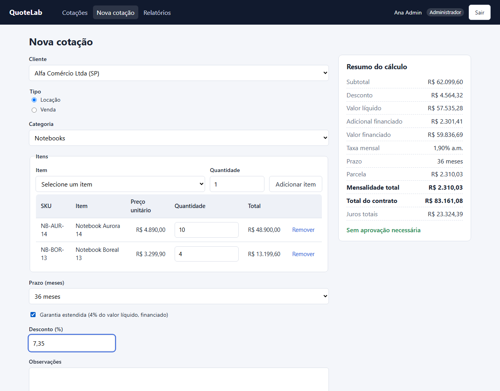
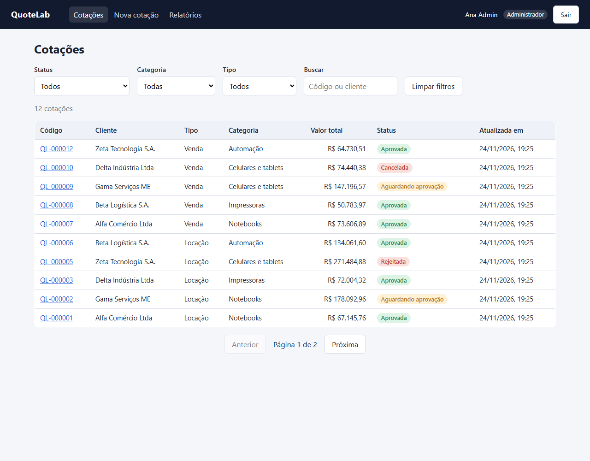
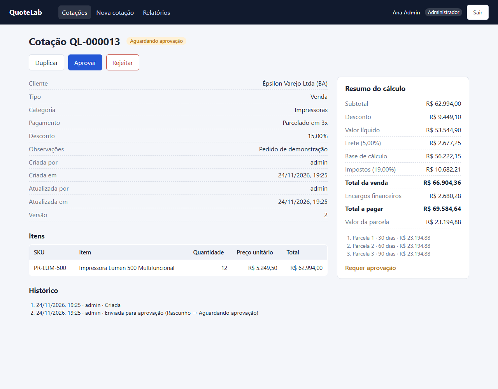
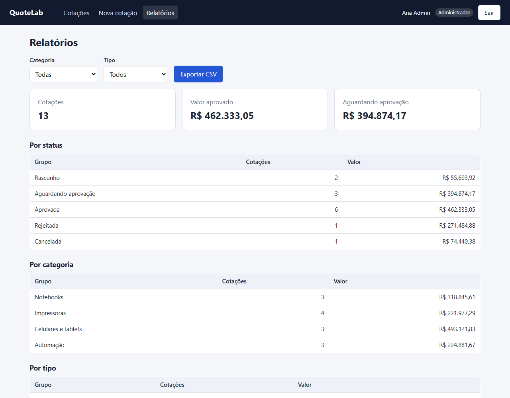
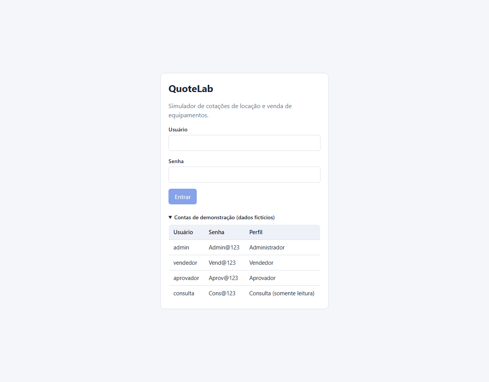

# QuoteLab · Vitrine de automação de testes

[](https://github.com/LucasBonno/qa-automation-showcase/actions/workflows/ci.yml)
[](https://playwright.dev)
[](LICENSE)

🇧🇷 Português · 🇬🇧 [English](README.md)

Projeto de automação de testes ponta a ponta com **Playwright e TypeScript**. Ele testa o **QuoteLab**, um pequeno simulador de cotações de locação e venda de equipamentos que vive neste mesmo repositório. Qualquer pessoa clona e roda **os 415 testes em cerca de dois minutos e meio**, sem conta, sem serviço externo e sem configuração além de `npm install`.

> **Relatórios publicados:** <https://lucasbonno.github.io/qa-automation-showcase/> (atualizados pelo CI a cada push na `main`).
>
> O QuoteLab e todos os seus dados são fictícios. Este repositório não tem relação com nenhum empregador ou cliente.



## Escopo: o que este repositório é e o que não é

O QuoteLab é pequeno de propósito. Ele existe para que as **técnicas** possam ser mostradas em público, rodando de ponta a ponta, num sistema que eu controlo por inteiro. Não é cópia de nenhum sistema em que já trabalhei e não tenta ter o tamanho de um.

Esses padrões vêm do meu trabalho diário numa grande plataforma web B2B, privada, de propostas comerciais e precificação. O código e os dados dela não são meus para publicar, e esse trabalho tem dificuldades que esta vitrine deliberadamente não tem:

| Numa suíte grande e privada | Neste repositório |
|---|---|
| Ambiente de teste compartilhado, às vezes lento ou instável. O teste espera a tela, e um tempo esgotado é classificado como "lentidão", não como bug do produto | Servidor local que sobe em segundos e é totalmente controlado |
| Dados de negócio existentes que os testes não podem destruir, então cada teste primeiro restaura o estado de que precisa | Cada teste cria e limpa os próprios dados |
| Várias linhas de produto num mesmo framework, cada uma com regras de negócio próprias | Quatro categorias num roteiro compartilhado |
| Um livro de regras de negócio escrito, cada regra com sua origem, usado para decidir se um achado é bug confirmado, suspeita ou comportamento esperado | Uma tabela curta de regras (abaixo) |
| Falhas cruzadas com a ferramenta de gestão de itens de trabalho | Um resumo de uma página da execução |
| Mais de mil testes de interface, com veredito tirado do que a tela mostra | 415 testes, pela interface e pela API |

Se quiser conversar sobre o sistema maior, posso descrever a abordagem numa entrevista, sem compartilhar nada confidencial.

## O que este projeto demonstra

| Habilidade | Onde ver |
|---|---|
| **Oráculos de cálculo**: cada valor na tela é conferido contra uma fórmula independente, em aritmética exata com `BigInt`, nunca contra o código do próprio app | [`framework/oracles/`](framework/oracles) |
| **Arquitetura em camadas**: Page Objects, cliente de API tipado, fixtures que limpam o que criam, fábricas de cenários | [`framework/`](framework) |
| **Um roteiro, várias categorias**: os mesmos roteiros de locação e venda rodam para quatro categorias, cada uma com taxa, limite e adicional próprios | [`framework/suites/`](framework/suites) |
| **Dados guiados por limites**: a linha de aprovação é *encontrada* com o oráculo (busca binária) e testada uma unidade antes e depois | [`framework/factory/scenarios.ts`](framework/factory/scenarios.ts) |
| **Testes de UI determinísticos**: sem `sleep`. O app publica o estado da tela e o teste espera por ele | [`BasePage.ready`](framework/pages/base.page.ts) |
| **Controle de acesso**: matriz completa perfil × ação, tokens forjados, sessão expirada, duas abas do navegador | [`suites/access/`](suites/access) |
| **Contrato da API e persistência**: mensagens de validação, máquina de estados, controle de versão otimista, trilha de auditoria conferida no armazenamento | [`suites/api/`](suites/api) |
| **Desenho da execução**: dependências entre projetos, portão de smoke, suítes de leitura em paralelo, suítes que alteram dados sozinhas e por último | [`playwright.config.ts`](playwright.config.ts) |
| **Os testes pegam defeitos?** Uma verificação de mutação injeta 10 defeitos propositais e confere que as suítes falham | [`scripts/mutation-check.mjs`](scripts/mutation-check.mjs) |
| **CI/CD**: checagem de tipos, lint, execução completa e relatórios no GitHub Pages | [`.github/workflows/ci.yml`](.github/workflows/ci.yml) |
| **Relatório próprio**: resumo de uma página da execução, em português e inglês | [`framework/reporter/`](framework/reporter) |

## Experimente

### Opção 1: veja funcionando, sem instalar nada (1 minuto)

| O quê | Onde |
|---|---|
| Os testes passaram? | O selo verde de **CI** no topo desta página: a cada envio, todos os 416 passos rodam numa máquina Linux limpa |
| O relatório dos testes, com capturas de tela e traces | <https://lucasbonno.github.io/qa-automation-showcase/> |
| O resumo da execução em uma página | [Português](https://lucasbonno.github.io/qa-automation-showcase/summary/index.pt.html) · [English](https://lucasbonno.github.io/qa-automation-showcase/summary/index.en.html) |
| Como é o aplicativo | As [telas](#telas) abaixo |
| Os logs de uma execução real | A aba [Actions](https://github.com/LucasBonno/qa-automation-showcase/actions) |

### Opção 2: rodar no seu computador, passo a passo (cerca de 5 minutos)

**Você precisa de dois programas gratuitos.** Se já tem, pule esta parte.

| Programa | Download | Como conferir se funciona |
|---|---|---|
| Git | <https://git-scm.com/downloads> | abra um terminal e digite `git --version` |
| Node.js (versão "LTS", 20.12 ou mais nova) | <https://nodejs.org> | digite `node -v` |

**1. Abra um terminal.** É a janela onde você digita comandos.
- **Windows:** aperte a tecla `Windows`, digite `PowerShell` e dê Enter.
- **macOS:** aperte `Cmd + Espaço`, digite `Terminal` e dê Enter.
- **Linux:** aperte `Ctrl + Alt + T`.

**2. Baixe o projeto.** Copie cada bloco, cole no terminal e dê Enter.

Windows (PowerShell). Use uma pasta fora do OneDrive, que tenta sincronizar milhares de arquivos pequenos:
```powershell
mkdir C:\dev
cd C:\dev
git clone https://github.com/LucasBonno/qa-automation-showcase.git
cd qa-automation-showcase
```

macOS ou Linux:
```bash
cd ~
git clone https://github.com/LucasBonno/qa-automation-showcase.git
cd qa-automation-showcase
```

**3. Instale o que o projeto precisa** (só na primeira vez; o navegador tem cerca de 130 MB):
```bash
npm install
npx playwright install chromium
```

**4. Rode a verificação rápida** (13 testes, cerca de 8 segundos):
```bash
npm run smoke
```
Você deve ver `13 passed`.

**5. Rode tudo** (cerca de 2,5 minutos):
```bash
npm test
```
Você deve ver `416 passed` (os 415 testes mais um passo que restaura os dados de exemplo).

**6. Abra o relatório.** Ele abre no navegador:
```bash
npm run report
```

Todos os comandos acima precisam ser digitados **dentro da pasta `qa-automation-showcase`**. Se aparecer "Missing script" ou "package.json not found", você está na pasta errada: repita `cd qa-automation-showcase`.

### Quer ver os testes acontecendo?

**A execução inteira, uma janela de navegador por vez** (cerca de 3 a 4 minutos):
```bash
npm run test:watch
```

**Uma suíte só, devagar o bastante para acompanhar a olho nu** (o melhor jeito de demonstrar):
```bash
npm run suite -- lease-notebooks --headed
```
Um navegador de verdade abre e preenche o formulário de cotação sozinho. Troque `lease-notebooks` por qualquer suíte: `smoke`, `access`, `api`, `workflow`, `lease-mobile`, `sale-printers`, `reports` e assim por diante.

Os testes são rápidos, então acrescente uma pausa entre as ações do navegador com `PW_SLOWMO` (em milissegundos):

| Terminal | Comando |
|---|---|
| PowerShell (Windows) | `$env:PW_SLOWMO = 300` e depois `npm run test:watch` |
| macOS, Linux | `PW_SLOWMO=300 npm run test:watch` |

Com pausa, a execução completa fica bem mais longa, então combine com uma suíte só. Para voltar à velocidade normal no PowerShell: `Remove-Item Env:PW_SLOWMO`. Suítes que só chamam a API (`api`) não abrem janela, porque não têm tela.

Para uma visão guiada, em que você clica num teste e vê cada passo com a sua tela:
```bash
npx playwright test --no-deps --project=smoke --ui
```

### Quer usar o aplicativo manualmente?

```bash
npm run app
```
Abra <http://localhost:4173> e entre com `admin` / `Admin@123` (as outras três contas aparecem na tela de login). Crie uma cotação, mude o desconto e veja o painel de cálculo atualizar. Para parar, use `Ctrl + C`.

### Algo deu errado?

| Sintoma | O que fazer |
|---|---|
| `git` ou `node` "não é reconhecido" | O programa não está instalado, ou o terminal foi aberto antes da instalação. Instale e abra um terminal novo |
| A porta 4173 já está em uso | Use outra porta. PowerShell: `$env:PORT=4180`. macOS e Linux: `export PORT=4180`. Depois rode o comando de novo |
| Erros `ENOENT` em arquivos `.trace` (Windows com OneDrive ou Dropbox) | O programa de sincronização está travando a pasta. Rode `$env:PW_OUTPUT_DIR="$env:TEMP\pw-out"` antes dos testes, ou clone numa pasta fora do OneDrive |
| "Executable doesn't exist" / navegador não encontrado | Rode `npx playwright install chromium` de novo |
| Continua travado | Abra uma [issue](https://github.com/LucasBonno/qa-automation-showcase/issues) com o texto do erro |

## As suítes de teste

415 testes em 13 suítes. Cada linha é uma verificação diferente. As categorias reaproveitam o mesmo roteiro de propósito, porque cada uma tem números diferentes (taxa, limite, adicional).

| Suíte | Testes | O que cobre |
|---|---:|---|
| `smoke` | 13 | Endpoints de saúde, rotas protegidas, login dos quatro perfis, logout. Se falhar, nada mais roda. |
| `access` | 41 | Login e tratamento de token, tokens forjados e expirados, matriz perfil × ação, o que cada perfil enxerga, adulteração do armazenamento do navegador, sessão em várias abas. |
| `api` | 50 | CRUD, validação de cada campo, corpos malformados e grandes demais, atribuição em massa, a máquina de estados de aprovação (todo status × toda ação), versão otimista, persistência e trilha de auditoria. |
| `workflow` | 39 | O ciclo de vida da cotação pela interface, validação do formulário, XSS nas observações, clique duplo, duas pessoas editando a mesma cotação, comportamento da tela de edição. |
| `lease-notebooks` · `lease-printers` · `lease-mobile` · `lease-automation` | 31 cada | Cálculo da locação (8 cenários por API e por tela), todos os prazos de 12 a 60 meses (amortização até zero), limites de quantidade, linha de aprovação, o adicional da categoria. |
| `sale-notebooks` · `sale-printers` · `sale-mobile` | 32 · 26 · 26 | Cálculo da venda (8 cenários por API e por tela), frete e imposto por estado (os seis estados), pagamento à vista, estendido e parcelado, linha de aprovação. |
| `reports` | 55 | A lista de cotações (paginação, filtros, busca, botão voltar) e os relatórios (totais por status, categoria e tipo, exportação CSV), sobre uma massa conhecida restaurada antes da suíte. |
| `reports-live` | 9 | Relatórios reagindo a mudanças reais (aprovar, cancelar, rejeitar, excluir, editar), e ordenação e paginação em dados estáveis. Roda sozinha, por último. |

## Como um cálculo é verificado

O teste nunca pergunta ao aplicativo qual é a resposta certa. Ele calcula a partir das regras de negócio escritas, em aritmética exata, e compara os **centavos inteiros** que a tela expõe *e* o **texto** que o usuário lê.

```ts
// framework/oracles/money.ts: parcela constante, aritmética racional exata
//   PMT = PV · b · Aⁿ / (D · (Aⁿ − Dⁿ))      com A = D + b, D = 10 000, b = taxa em pontos-base
export function pmt(presentValueCents: number, rateBps: number, months: number): number {
  const n = BigInt(months);
  const a = D + BigInt(rateBps);
  const aN = a ** n;
  const dN = D ** n;
  return Number(roundHalfUp(BigInt(presentValueCents) * BigInt(rateBps) * aN, D * (aN - dN)));
}
```

O próprio oráculo é validado por uma propriedade: pagar a parcela *n* vezes deve deixar o saldo do financiamento dentro do resíduo de arredondamento ([`amortizationResidue`](framework/oracles/money.ts)).

## Os testes realmente pegam defeitos?

`npm run mutation-check` injeta um defeito proposital por vez no aplicativo e roda a suíte que deveria percebê-lo. Último resultado: **10 de 10 pegos**.

| ID | Defeito injetado | Pego por | Testes que falharam |
|---|---|---|---:|
| M1 | Arredondamento: "para cima" vira "para baixo" | `lease-notebooks` | 5 |
| M2 | Linha de aprovação: "acima de 10%" vira "10% ou mais" | `lease-printers` | 2 |
| M3 | Um vendedor pode aprovar cotações | `access` | 3 |
| M4 | A quantidade máxima aceita uma unidade a mais | `lease-mobile` | 1 |
| M5 | A parcela compõe *n − 1* períodos | `sale-printers` | 10 |
| M6 | A lista mostra todo valor um centavo acima | `reports` | 1 |
| M7 | Versões antigas deixam de ser detectadas (perda de atualização) | `api` | 1 |
| M8 | Imposto sobre o valor líquido em vez de líquido + frete | `sale-notebooks` | 28 |
| M9 | O CSV perde a marca de ordem de bytes UTF-8 | `reports` | 1 |
| M10 | O adicional marcado é ignorado na prévia ao vivo | `lease-automation` | 6 |

A primeira versão do script apontou um "sobrevivente". A investigação mostrou um servidor antigo sendo reaproveitado, e não uma lacuna nos testes, então o script agora se recusa a reaproveitar servidores. Um teste também encontrou um defeito real no próprio app (o campo de busca perdia o foco durante a digitação), já corrigido neste repositório.

## Arquitetura

```text
app/                  QuoteLab: API em Express + TypeScript, front-end em JavaScript puro
framework/
  oracles/            regras de negócio escritas de forma independente + matemática de dinheiro exata
  api/                cliente de API tipado (não lança erro em status HTTP, facilita os testes negativos)
  pages/              Page Objects (papéis, rótulos e test ids, sem XPath)
  factory/            cenários, construtores de payload, a massa de dados do seed
  fixtures/           fixtures do Playwright: API admin, API por perfil, injeção de sessão, limpeza automática
  assertions/         "painel de resumo igual ao oráculo" em uma chamada
  suites/             os roteiros de locação e venda compartilhados pelas suítes de categoria
  reporter/           resumo de uma página da execução (pt/en)
suites/               uma pasta por projeto: os arquivos de teste
scripts/              verificação de mutação, capturas de tela, gerador do site
```

Mais detalhes em [`docs/architecture.md`](docs/architecture.md).

### Regras de negócio do QuoteLab

| Regra | Valor |
|---|---|
| Prazos de locação | 12, 24, 36, 48 ou 60 meses |
| Taxa mensal por categoria | Notebooks 1,90% · Impressoras 2,40% · Celulares 2,90% · Automação 2,20% |
| Adicional por categoria | Notebooks: garantia (4% do líquido, financiada) · Impressoras: kit de suprimentos (R$ 45,00/unidade/mês) · Celulares: seguro (1,2% do líquido ao mês) · Automação: instalação (R$ 180,00/unidade, financiada) |
| Desconto | 0% a 30%; **acima de 10%** exige aprovação |
| Aprovação por valor | Valor principal **acima de R$ 100.000,00** exige aprovação |
| Venda | líquido + frete (por estado) + imposto (por estado); à vista, estendido 30 dias (+1,5%) ou 2 a 3 parcelas (1,99% a.m.) |
| Perfis | Administrador, Vendedor (só as próprias cotações), Aprovador, Consulta (somente leitura) |

### Contas de demonstração

| Usuário | Senha | Perfil |
|---|---|---|
| `admin` | `Admin@123` | Administrador |
| `vendedor` | `Vend@123` | Vendedor |
| `aprovador` | `Aprov@123` | Aprovador |
| `consulta` | `Cons@123` | Consulta |

São credenciais de um ambiente de demonstração com dados fictícios, publicadas de propósito (também aparecem na tela de login).

## Telas

| | |
|---|---|
|  |  |
|  |  |

## Todos os comandos

| Comando | O que faz |
|---|---|
| `npm test` | Todas as suítes, na ordem das dependências |
| `npm run test:watch` | O mesmo, com o navegador visível, uma janela por vez |
| `npm run smoke` · `access` · `api` · `workflow` | Uma suíte base (sem dependências) |
| `npm run lease` · `sale` | As quatro suítes de locação ou as três de venda |
| `npm run reports` | Restaura o seed, roda as suítes de relatório e depois as "ao vivo" |
| `npm run suite -- <projeto>` | Qualquer projeto isolado, por exemplo `npm run suite -- lease-mobile` |
| `npm run list` | Lista todos os testes sem executá-los |
| `npm run check` | Checagem de tipos, lint e descoberta dos testes |
| `npm run mutation-check` | Injeta defeitos propositais e confere que os testes os pegam |
| `npm run site` | Monta o site do GitHub Pages a partir da última execução |
| `npm run screenshots` | Regera as imagens em `docs/img` |

## Configuração

| Variável | Padrão | Significado |
|---|---|---|
| `BASE_URL` | sobe o próprio servidor em `http://localhost:4173` | Testa um QuoteLab já em execução (precisa rodar com `QL_TEST_MODE=1`) |
| `PORT` | `4173` | Porta do app que o Playwright inicia |
| `REPORT_LANG` | `pt` | Idioma de `reports/summary/index.html` (`pt` ou `en`; os dois arquivos são sempre gerados) |
| `PW_OUTPUT_DIR` | `reports/test-results` | Onde ficam capturas de tela e traces |
| `PW_FRESH_SERVER` | não definida | `1` nunca reaproveita um servidor em execução |
| `PW_SLOWMO` | `0` | Milissegundos de espera entre as ações do navegador. Use com `--headed` para acompanhar a execução a olho nu, por exemplo `300` |

`QL_TEST_MODE=1` habilita três endpoints exclusivos de teste (restaurar dados, despejar o armazenamento, tokens de curta duração). Ele nunca é necessário para usar o app.

## Licença

[MIT](LICENSE) © Lucas Bonno
