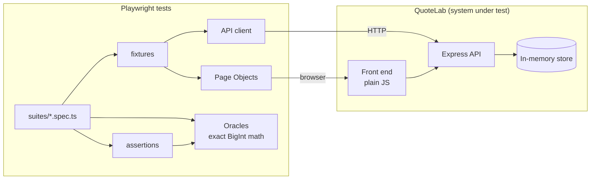
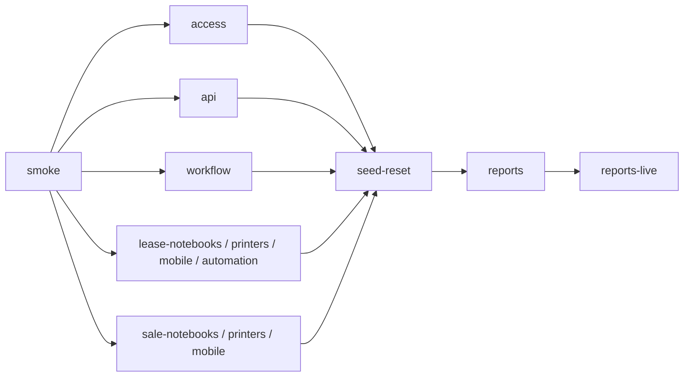

# Architecture · Arquitetura

🇬🇧 English first, 🇧🇷 português logo abaixo de cada seção.

## 1. The big picture · Visão geral

EN: tests talk to the system in two ways, through the browser (Page Objects) and straight to the HTTP API. Both are compared with the **oracles**, which do not import any application code.

PT: os testes falam com o sistema de duas formas, pelo navegador (Page Objects) e direto na API HTTP. As duas são comparadas com os **oráculos**, que não importam nenhum código do aplicativo.

## 2. Why the oracle does not share code with the app · Por que o oráculo não reaproveita código do app

EN: if the test imported the app's formulas, a bug in a formula would be "confirmed" by the test. The oracle keeps its own table of rules ([`framework/oracles/spec.ts`](../framework/oracles/spec.ts)) and its own exact math (`BigInt`). When the app and the table disagree, a test fails and a person decides which one is right. The mutation check ([`scripts/mutation-check.mjs`](../scripts/mutation-check.mjs)) proves that this works.

PT: se o teste importasse as fórmulas do app, um erro na fórmula seria "confirmado" pelo teste. O oráculo mantém a própria tabela de regras ([`framework/oracles/spec.ts`](../framework/oracles/spec.ts)) e a própria matemática exata (`BigInt`). Quando app e tabela divergem, um teste falha e uma pessoa decide quem está certo. A verificação de mutação ([`scripts/mutation-check.mjs`](../scripts/mutation-check.mjs)) prova que isso funciona.

## 3. Execution order · Ordem de execução

EN: `smoke` is a gate: if the system is down, nothing else runs. The feature suites create their own data and run in parallel. `seed-reset` restores a known data set once they all finish; `reports` only reads it, so it runs in parallel; `reports-live` changes data and compares totals before and after, so it runs alone and last.

PT: o `smoke` é um portão: se o sistema está fora do ar, nada mais roda. As suítes de funcionalidade criam seus próprios dados e rodam em paralelo. O `seed-reset` restaura uma massa conhecida quando todas terminam; o `reports` só lê, então roda em paralelo; o `reports-live` altera dados e compara totais antes e depois, então roda sozinho e por último.

## 4. Waiting without sleeping · Esperar sem dormir

EN: single-page apps change the screen without a page load, so "the page loaded" says nothing. The front end publishes `data-route` and `data-state` on its root element. Page Objects wait for the **route they expect to be `ready`**, which also protects against reading the previous screen after a hash navigation. The live calculation panel does the same with `data-state="ready"`. The lint rule forbids `waitForTimeout`.

PT: aplicações de página única trocam a tela sem recarregar, então "a página carregou" não diz nada. O front-end publica `data-route` e `data-state` no elemento raiz. Os Page Objects esperam pela **rota que esperam estar `ready`**, o que também evita ler a tela anterior depois de uma navegação por hash. O painel de cálculo ao vivo faz o mesmo com `data-state="ready"`. A regra de lint proíbe `waitForTimeout`.

## 5. Test data · Massa de dados

EN:
- Tests create their own quotes through the API and register them with the `track` fixture, which **cleans up** after the test (drafts are deleted, pending ones rejected and deleted, approved ones cancelled).
- Reports need exact totals, so they start from the **seed data set**, restored by a test-mode endpoint and described independently in [`framework/factory/seed.ts`](../framework/factory/seed.ts).
- Scenario tables ([`framework/factory/scenarios.ts`](../framework/factory/scenarios.ts)) put data where bugs hide: smallest and largest quantities, fractional discounts, odd-cent prices, both sides of each threshold.

PT:
- Os testes criam suas próprias cotações pela API e as registram na fixture `track`, que **limpa** depois do teste (rascunhos são excluídos, pendentes rejeitadas e excluídas, aprovadas canceladas).
- Os relatórios precisam de totais exatos, então partem da **massa do seed**, restaurada por um endpoint do modo de teste e descrita de forma independente em [`framework/factory/seed.ts`](../framework/factory/seed.ts).
- As tabelas de cenários ([`framework/factory/scenarios.ts`](../framework/factory/scenarios.ts)) colocam dados onde os defeitos se escondem: menores e maiores quantidades, descontos fracionários, preços com centavos quebrados, os dois lados de cada limite.

## 6. Test-mode endpoints · Endpoints do modo de teste

EN: with `QL_TEST_MODE=1` the server exposes `POST /api/__test__/reset`, `GET /api/__test__/db` (raw store, used to check persistence and audit fields) and accepts `ttlSeconds` on login (to test expiry without waiting two hours). They are off by default.

PT: com `QL_TEST_MODE=1` o servidor expõe `POST /api/__test__/reset`, `GET /api/__test__/db` (armazenamento bruto, usado para conferir persistência e campos de auditoria) e aceita `ttlSeconds` no login (para testar expiração sem esperar duas horas). Vêm desligados por padrão.
